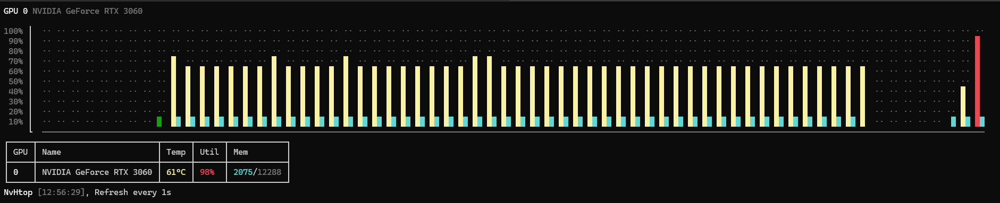

# Cross-platform NVIDIA GPU utilization CLI viewer

## Requirements

* `nvidia-smi` (part of CUDA driver installation).
* Dotnet 10 SDK (>= preview 5)

## Usage

```bash
dotnet run --file nvsharptop.cs -- [--sample-interval <sec>] [--display-interval <sec>]
```

On Linux machines, if you wish to run the tool directly, you can:

* Add: `#!/usr/bin/dotnet` to the first line
* Run `chmod +x nvsharptop.cs` to enable running the script directly.

And then run like so: nvsharptop.cs

### Example output



When multiple GPUs are present, the app provides three display modes: a metrics table, a compact grid of utilization and memory meters, and utilization/memory sparklines showing recent history. Press `A`, `B`, or `C` to select a mode, `Tab` to cycle between them, or `Q` to quit.

## Notice

This tool was developed with the aid of Copilot in VS Code in agent mode.
